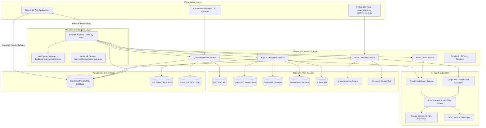

# 01 — Architecture & System Design

## 1. Executive Summary

The **VMS Automation System** is engineered to transform unstructured and semi-structured vulnerability scanner outputs into enriched cyber risk intelligence. Traditional scanning mechanisms (such as Qualys VMDR, Tenable Nessus, or Rapid7) produce vast tabular reports that overwhelm security teams with unprioritized CVSS scores and generic remediation text. 

This platform bridges scanner outputs and security operations by introducing:
- Automated multi-source CVE intelligence enrichment (NVD, CVE.org, OSV).
- Autonomous AI agent teams for contextual risk assessment, business impact derivation, and actionable remediation engineering.
- Real-time exploit intelligence aggregation from live repositories (GitHub PoCs, Exploit-DB, PacketStorm, Vulners).
- Asset contextualization combining network scanning (Nmap), passive external reconnaissance, IP reputation scoring, and LLM-driven role inference.
- Automated generation of enterprise Excel deliverables and PowerPoint presentation decks.

---

## 2. Architectural Blueprint

The system follows a modular, decoupled architecture supporting both real-time asynchronous web interaction (FastAPI + Next.js) and standalone automated CLI/Streamlit pipelines.



---

## 3. Directory Layout & Module Responsibilities

The root directory contains the following modular boundaries:

```
vms_automation/
├── backend/                  # FastAPI Application & Business Logic
│   ├── core/                 # Core domain algorithms
│   │   ├── asset_criticality/ # IP intelligence, Nmap, risk and role scoring
│   │   └── exploit_search/    # Exploit-DB, GitHub, PacketStorm, Vulners connectors
│   ├── db/                   # Database client (Supabase) and SQL queries
│   ├── queue/                # Redis background queue abstraction
│   ├── routes/               # API route definitions (assets, qualys, exploit, recon, ws)
│   └── services/             # High-level business flows (QualysProcessor, AttackChain)
├── frontend/                 # Next.js 15 App Router Frontend Application
│   ├── app/                  # App Router pages (dashboard, asset-scanning, cve-exploitability)
│   ├── components/           # UI components (FileUpload, ResultsTable, Sidebar, WSListener)
│   ├── lib/                  # Frontend API client and utilities
│   └── store/                # Zustand client-side state stores
├── enhanced_cve_search/      # Advanced CVE matching, semantic scoring, threaded validation
├── utils/                    # Core helpers (remediation agent, risk assessment, export engine)
├── main_config/              # Production LLM manager, rate-limiter, multi-key rotator
├── config/                   # API key configuration and fallback managers
├── single_vulnerability/     # Isolated one-off CVE analysis utilities
├── vms_ppt/                  # PowerPoint automation engine (python-pptx)
├── input/                    # Raw input sample vulnerability files (.xlsx, .csv)
├── output/                   # Processed vulnerability exports
├── results/                  # Exploitability cache and static JSON result dumps
├── cache/                    # Disk cache for CVEs, IP intel, and exploit queries
├── logs/                     # JSONL session event logs
├── main.py                   # FastAPI backend launcher
├── report.py                 # Streamlit application entry point
├── asset_agent.py            # CLI entry point for asset criticality
└── passive_recon.py          # CLI entry point for external asset discovery
```

---

## 4. End-to-End Processing Lifecycles

### 4.1 Qualys Report Ingestion & Enrichment Flow

1. **Ingestion**: The user uploads a Qualys Excel/CSV report through the frontend (`/api/upload` or `/api/qualys/upload`) or launches `report.py`.
2. **Session Initialization**: The backend creates a scan session record in Supabase with status `queued` or `processing`. Each vulnerability row is extracted into individual row records.
3. **Multi-Threaded CVE Resolution**:
   - `enhanced_cve_search/improved_cve_search.py` parses the vulnerability title and description.
   - Generates semantic search queries using LLM or rule-based heuristics.
   - Simultaneously queries NIST NVD, CVE.org, and OSV DB.
   - `threaded_cve_validator.py` applies token-based Jaccard similarity and semantic scoring to filter out false-positive CVE mappings.
4. **Autonomous AI Risk & Remediation Assessment**:
   - For each verified vulnerability, CrewAI/LangChain spin up specialized agents:
     - **Risk Agent**: Computes business risk category, financial/operational risk score (1-100), remediation urgency, and potential exploitation vectors.
     - **Remediation Agent**: Formulates step-by-step patch/workaround guidance, verification commands, and rollback instructions.
5. **Exploitability Discovery**:
   - Concurrently checks GitHub for public PoC exploits, queries Exploit-DB, PacketStorm, and Vulners.
   - Evaluates whether weaponized, active, or theoretical exploit code exists.
6. **Persistence & Streaming**:
   - Processed findings are committed to Supabase (`qualys_rows`).
   - Progress events are pushed over WebSockets (`/ws`) to update the frontend progress bars in real time.
7. **Export Generation**:
   - Clean, formatted Excel reports are produced with dynamic prioritization matrices, TruRisk calculations, and SLA status indicators.

---

### 4.2 Asset Criticality & Role Inference Flow

1. **Target Specification**: IP address, optional declared role, and environment flags are provided via CLI or REST API (`/api/assets/analyze`).
2. **IP Reconnaissance & Threat Intel**:
   - Queries `ipinfo.io` for geolocation, ASN, and organization.
   - Queries `AbuseIPDB` for abuse confidence scores and threat reporting history.
   - Queries `Shodan` for exposed ports, historical banners, and vulnerability tags.
3. **Nmap Scan Execution**:
   - Executes an active port scan (`-sV -sC -Pn --top-ports 1000` or custom profiles) to determine exact software names, versions, and service banners.
4. **Automated Role Inference**:
   - An LLM analyzes the combination of listening ports, banner strings, ASN, and reverse DNS to categorize the server role (e.g., `Database Server (PostgreSQL)`, `Internal Active Directory DC`, `Public Edge Reverse Proxy`).
5. **Criticality Scoring**:
   - Synthesizes declared environment, data classification, internet exposure, and running software into a composite **Asset Criticality Score (1–10)** and tier (`CRITICAL`, `HIGH`, `MEDIUM`, `LOW`).

---

## 5. Concurrency & Performance Model

- **Thread Pooling**: ThreadPoolExecutors are utilized in `report.py` and `enhanced_cve_search` to parallelize HTTP calls against NVD, GitHub, and AI endpoints, reducing processing times for large reports.
- **Rate-Limit Throttling & Key Rotation**: Handled transparently by `main_config/llm_manager.py`. Up to 10 Gemini API keys and 4 Groq API keys are monitored in a round-robin rotation pool with exponential backoff on `429 Too Many Requests`.
- **Two-Tier Caching**:
  - **Memory/Disk Cache**: SHA256 hashed queries stored in `/cache/*.json` with configurable TTL (default 24h) to avoid duplicate API calls to NVD and Shodan.
  - **Database Persistence**: Supabase stores finalized asset evaluations and exploit summaries to ensure instant query times for previously scanned assets.
