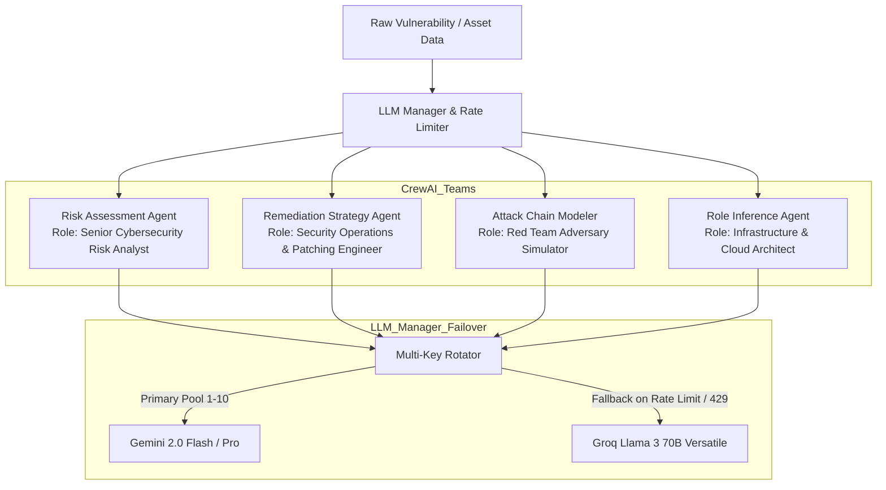

# 04 — AI Multi-Agent Pipeline & LLM Management

VMS Automation uses autonomous agent orchestration built with **CrewAI** and **LangChain**. Rather than using generic single-prompt completions, specialized agents handle discrete phases of cyber intelligence analysis.

---

## 1. Multi-Agent Ecosystem Architecture

---

## 2. Agent Inventory & Prompts

### 2.1 Risk Assessment Agent
- **Source**: `utils/risk_assessment.py` and `backend/services/qualys_processor.py`
- **Agent Role**: Senior Information Security Risk Assessor.
- **Task**: Evaluate raw scanner data (`Vulnerability Name`, `Port`, `Service`, `CVSS Score`, `Threat Context`) and convert it into business risk metrics.
- **Key Output Fields**:
  - `Risk_Category`: Operational, Compliance, Financial, Data Loss, or System Availability.
  - `Risk_Score`: Calibrated integer score (0–100).
  - `Business_Impact`: Clear explanation of operational and financial consequences if exploited.
  - `Remediation_Urgency`: Immediate (24h), High (7d), Medium (30d), or Low (90d).
  - `Risk_Immediate_Actions`: Initial triage steps to mitigate exposure prior to full patching.
  - `Exploitation_Methods`: Realistic attack techniques (e.g., Unauthenticated RCE, Credential Stuffing).

---

### 2.2 Remediation Agent
- **Source**: `utils/remediation_agent.py`
- **Agent Role**: Principal Security Infrastructure Engineer.
- **Task**: Provide production-ready mitigation steps with verification and rollback strategies.
- **Key Output Fields**:
  - `Remediation_Guide`: High-level summary of the fix.
  - `Remediation_Priority`: Categorized based on exploitability and asset criticality.
  - `Estimated_Effort`: Estimated engineer-hours required for implementation and testing.
  - `Immediate_Actions`: Temporary mitigations (e.g., firewall rule changes, disabling vulnerable service flags).
  - `Detailed_Steps`: Exact shell commands, registry adjustments, or software package update procedures.
  - `Verification_Steps`: Specific test commands or curl queries to prove the vulnerability is resolved.
  - `Rollback_Plan`: Recovery procedures if the patch causes operational disruption.
  - `Reference_Links`: Vendor security advisories and official documentation.

---

### 2.3 Attack Chain Simulation Agent
- **Source**: `backend/services/attack_chain_service.py`
- **Agent Role**: Senior Red Team Penetration Tester.
- **Task**: Analyze all discovered vulnerabilities for a specific target IP and model multi-stage adversary execution.
- **Execution Structure**:
  1. **Phase 1: Initial Reconnaissance & Entry Vector**: Identifies which open port or web flaw serves as the breach point.
  2. **Phase 2: Local Weaponization & Privilege Escalation**: Details how an attacker elevates permissions (e.g., from unprivileged user to root/SYSTEM).
  3. **Phase 3: Lateral Movement & Network Pivoting**: Maps reachable internal subnets or credential extraction targets.
  4. **Phase 4: Impact Analysis**: Data exfiltration, ransomware deployment, or complete host compromise.

---

### 2.4 Asset Role & Criticality Inference Agent
- **Source**: `backend/core/asset_criticality/role_inference.py` and `risk_scoring.py`
- **Agent Role**: Enterprise Cloud & Infrastructure Architect.
- **Task**: Correlate Nmap banners, open ports, reverse DNS, and IP intelligence to infer the actual workload of an unmanaged machine.
- **Heuristics & Reasoning**:
  - Ports 5432 / 3306 / 1433 / 27017 $\rightarrow$ Database Server.
  - Ports 80 / 443 with Nginx/Cloudflare $\rightarrow$ Edge Web Proxy / Ingress Controller.
  - Ports 88 / 389 / 445 / 636 $\rightarrow$ Active Directory Domain Controller.
  - Port 22 with OpenSSH on internal IP $\rightarrow$ Linux Management Bastion.

---

## 3. High-Throughput LLM Manager & Failover Engine

One of the platform's core innovations is **`main_config/llm_manager.py`** and **`config/api_key_manager.py`**, designed to prevent pipeline failures caused by rate limits.

### Multi-Key Round-Robin Rotation
- Automatically reads `GOOGLE_API_KEY`, `GOOGLE_API_KEY_1`, ..., `GOOGLE_API_KEY_10`.
- Tracks API call counts and timestamps per key.
- Rotates active keys sequentially to distribute request volume across individual API quotas.

### Automatic Fallback Cascade
When executing an LLM request:
1. Calls the active Google Gemini key (`gemini-2.0-flash` or `gemini-1.5-pro`).
2. If `ResourceExhausted` or HTTP `429 Too Many Requests` is encountered:
   - Rotates immediately to the next available Gemini key in the pool.
   - If all Gemini keys are rate-limited, gracefully switches to Groq (`llama-3.3-70b-versatile` or `llama-3.1-70b`).
3. If all LLM calls fail, invokes safe deterministic rule-based fallbacks (`_fallback_analysis` in `improved_cve_search.py` and `remediation_agent.py`) so the batch job never crashes.

### Structured JSON Logging (`main_config/llm_logger.py`)
- Every LLM invocation records:
  - Input prompt token estimate.
  - Model and provider used.
  - Latency in milliseconds.
  - Completion status (success, retry, or fallback).
  - Persisted to daily JSONL files in `logs/session_<timestamp>.jsonl` with an accompanying session summary.
