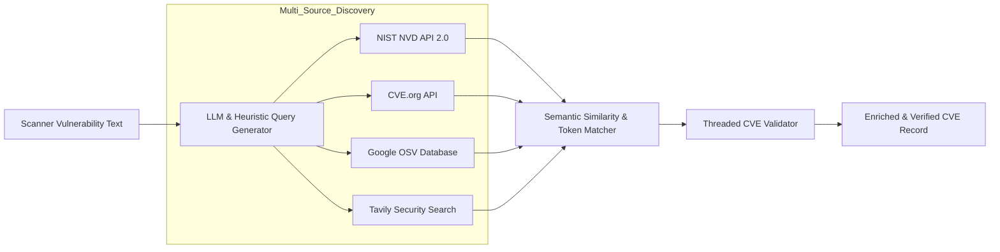
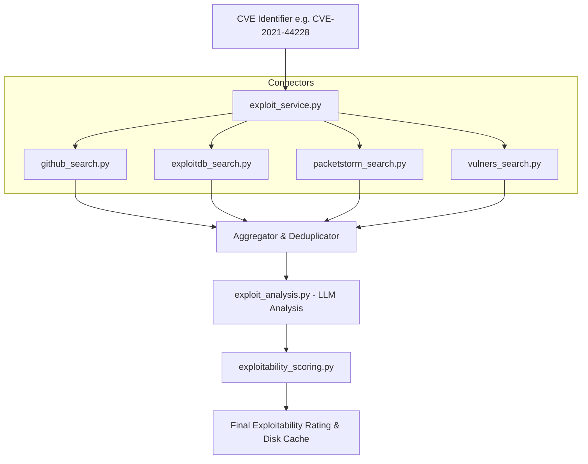

# 05 — Threat Intelligence & CVE Exploitability Engines

The threat intelligence subsystem powers accurate CVE discovery and real-time exploitability assessments. It correlates findings from multiple public vulnerability repositories and exploit repositories.

---

## 1. Multi-Source CVE Search Architecture

When raw vulnerability scanner text (e.g., `"Apache Tomcat Remote Code Execution Vulnerability"`) is processed, it may lack an explicit CVE identifier or require correlation across multiple vulnerability databases.

### 1.1 `enhanced_cve_search/improved_cve_search.py`
- Implements `EnhancedCVESearchSystem`.
- **Query Generation**: Deconstructs vulnerability descriptions into product names, versions, and vulnerability types (e.g., `["Apache Tomcat", "9.0.43", "Remote Code Execution", "RCE"]`).
- **NVD API Integration**: Queries `https://services.nvd.nist.gov/rest/json/cves/2.0` with API key support, handling rate limiting and extracting CVSS v2/v3.1 vector strings, exploitability sub-scores, and CWE classifications.
- **CVE.org & OSV Integration**: Handles open-source package vulnerabilities and ecosystem-specific advisories (Python/PyPI, Go, Rust/crates, Maven, npm).

### 1.2 Semantic Scoring & Validation (`threaded_cve_validator.py`)
To prevent false-positive CVE assignments:
- Implements `SemanticSimilarityMatcher`:
  - Token normalization and stop-word filtering.
  - **Jaccard Similarity**: Evaluates intersection over union on normalized token sets.
  - **Overlap Coefficient**: Handles length discrepancies between brief scan titles and lengthy NVD descriptions.
  - **Weighted Matcher**: Gives extra weight to software version tokens (e.g., matching `"2.4.49"` is weighted higher than matching generic words like `"vulnerability"`).
- Candidate CVEs below a threshold (default 0.45) are discarded or flagged as low-confidence.

---

## 2. Live Exploit Search Subsystem (`backend/core/exploit_search/`)

The platform connects to live exploit sources to determine if weaponized or proof-of-concept (PoC) exploit code is publicly circulating.

### 2.1 Connector Breakdown

| Source | File | Method | Description |
|--------|------|--------|-------------|
| **GitHub** | `github_search.py` | GitHub Search API | Searches repositories matching `${CVE_ID} poc`, `${CVE_ID} exploit`, filtering out empty or spam repos. Also searches `offensive-security/exploitdb` via GitHub Code Search. |
| **Exploit-DB** | `exploitdb_search.py` | Local CSV / Raw Database | Searches the official Exploit-DB vulnerability mapping index (`files_exploits.csv`) for verified exploit scripts. |
| **PacketStorm** | `packetstorm_search.py` | Web Search / Scraping | Queries PacketStorm Security advisory archives for published weaponized modules and advisories. |
| **Vulners** | `vulners_search.py` | REST API | Searches Vulners database for cross-referenced CVEs, Nessus plugins, and Metasploit modules. |

---

## 3. Exploitability Scoring Model

In `backend/core/exploit_search/exploitability_scoring.py`, exploit intelligence is synthesized into an **Exploitability Tier** and a normalized numeric score (0.0 to 10.0):

| Exploitability Tier | Score Range | Criteria |
|---------------------|-------------|----------|
| **WEAPONIZED** | 9.0 – 10.0 | Reliable, automated, or Metasploit/Cobalt Strike module available. Widely weaponized in the wild. |
| **ACTIVE_POC** | 7.0 – 8.9 | Functional Proof-of-Concept code available on GitHub or Exploit-DB; requires minimal adaptation. |
| **THEORETICAL** | 4.0 – 6.9 | Academic paper, advisory with reproduction steps, or partial PoC requiring significant reverse engineering. |
| **NONE_RECORDED** | 0.0 – 3.9 | No public PoC or exploit code found in indexed repositories. |

### LLM Exploit Synthesis
An LLM reviews raw code snippets, commit messages, and readmes returned by GitHub and PacketStorm to summarize:
- Attack complexity (unauthenticated vs authenticated).
- Reliability of the available exploit scripts.
- Likelihood of automated scanning/exploitation by threat actors.

---

## 4. Caching & Performance Considerations

- Exploit queries are cached locally in `cache/exploit_*.json` and Supabase table `cve_exploitability`.
- Default TTL: 24 hours. Bypassed by passing `force_refresh=True` in the API call.
- GitHub API queries include an authorization header when `GITHUB_TOKEN` is provided in `.env`, elevating the rate limit from 60 to 5,000 requests/hour.

