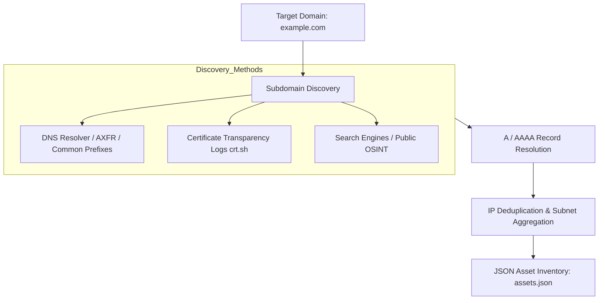

# 06 — Asset Criticality, Network Reconnaissance & Scanning

Asset contextualization is critical for vulnerability prioritization. A Critical CVE on an isolated internal development sandbox requires a different response compared to the same CVE on an internet-facing production payment gateway.

This module details how VMS Automation performs external domain reconnaissance, Nmap network scanning, IP threat intelligence enrichment, and automated asset criticality calculation.

---

## 1. Passive Domain Reconnaissance (`passive_recon.py`)

`passive_recon.py` discovers external attack surfaces without generating intrusive traffic on the target.



### CLI Usage:
```bash
# Basic domain reconnaissance
python passive_recon.py -d yourcompany.com

# Reconnaissance with custom output destination
python passive_recon.py -d yourcompany.com -o results/assets.json
```

### Key Extracted Attributes per Asset:
- Resolved IPv4 / IPv6 addresses.
- FQDN (Fully Qualified Domain Name).
- Reverse DNS PTR records.
- Heuristic data classification (`public`, `internal`, `confidential`, `restricted`).
- Inferred environment (`production`, `staging`, `dev`).

---

## 2. IP Threat Intelligence (`backend/core/asset_criticality/ip_intel.py`)

For any given target IP, `ip_intel.py` gathers OSINT to assess external exposure and reputation:

1. **IPInfo (`ipinfo.io`)**:
   - ASN number, organization name, hosting provider (AWS, GCP, Azure, DigitalOcean, Cloudflare), and country.
2. **AbuseIPDB**:
   - Abuse Confidence Score (0–100%), total reported abuse incidents, last reported timestamp, and categorized threat types (e.g., SSH brute force, web crawler, spam).
3. **Shodan**:
   - Exposed ports, open service banners, SSL/TLS certificates, and vulnerability tags previously seen on the IP.
4. **GreyNoise**:
   - Differentiates internet background noise, benign mass-scanners (e.g., Censys, Shodan, Qualys), and targeted threat actors.
5. **Internet-Facing Heuristic**:
   - Assesses whether an IP is truly edge-exposed based on public IP ranges, Cloudflare proxying, and Shodan visibility.

---

## 3. Network Scanning Engine (`backend/core/asset_criticality/nmap_scan.py`)

VMS Automation uses `python-nmap` to execute active network audits.

### Scan Profiles:
- **Fast Profile**: `--top-ports 100 -sV --version-light -T4`
- **Standard Profile**: `-sV -sC -Pn --top-ports 1000 -T4`
- **Full Deep Profile**: `-sV -sC -Pn -p- -O --version-all`

### Port & Service Normalization:
`nmap_scan.py` parses XML/dict outputs into a clean JSON structure:
```json
{
  "ip": "192.168.1.100",
  "status": "up",
  "hostname": "db-prod-01.internal",
  "open_ports": [
    {
      "port": 22,
      "protocol": "tcp",
      "service": "ssh",
      "product": "OpenSSH",
      "version": "8.9p1 Ubuntu 3ubuntu0.6",
      "cpe": "cpe:/a:openbsd:openssh:8.9p1"
    },
    {
      "port": 5432,
      "protocol": "tcp",
      "service": "postgresql",
      "product": "PostgreSQL DB",
      "version": "14.9"
    }
  ],
  "os_matches": ["Linux 5.4 - 5.15"]
}
```

---

## 4. Role Inference & Risk Scoring (`role_inference.py` & `risk_scoring.py`)

### 4.1 Asset Criticality Scoring Algorithm

The platform calculates a composite **Asset Criticality Score (1.0 to 10.0)** and classifies the asset into a tier (`CRITICAL`, `HIGH`, `MEDIUM`, `LOW`).

The score is synthesized from four weighted dimensions:

$$\text{Score} = w_{\text{env}} \cdot S_{\text{env}} + w_{\text{class}} \cdot S_{\text{class}} + w_{\text{role}} \cdot S_{\text{role}} + w_{\text{exposure}} \cdot S_{\text{exposure}}$$

Where:
- **Environment Weight ($S_{\text{env}}$)**:
  - `production`: 9.5
  - `staging`: 6.0
  - `development`: 3.0
  - `dr` (Disaster Recovery): 8.0
- **Data Classification Weight ($S_{\text{class}}$)**:
  - `restricted`: 10.0
  - `confidential`: 8.0
  - `internal`: 5.0
  - `public`: 2.0
- **Role Multiplier ($S_{\text{role}}$)**:
  - Database, Domain Controller, Key Vault, Payment Gateway: 9.0 – 10.0
  - Application Server, API Gateway: 7.0 – 8.0
  - Bastion / Jump Host: 7.5
  - Build Agent, CI/CD worker: 5.0 – 6.0
  - Development Test Host: 2.0 – 3.0
- **Exposure Multiplier ($S_{\text{exposure}}$)**:
  - Direct Public Internet Exposure: +1.5 to +2.0 boost.
  - Internal RFC1918 Private IP: Neutral / baseline.

### 4.2 Criticality Tiers

| Tier | Score Range | SLA for Critical CVEs | Description |
|------|-------------|-----------------------|-------------|
| **CRITICAL** | 8.5 – 10.0 | 24 Hours | Core business infrastructure, production databases, identity providers. |
| **HIGH** | 7.0 – 8.4 | 7 Days | Important production services, internal business applications. |
| **MEDIUM** | 4.0 – 6.9 | 30 Days | Non-critical internal tools, staging environments, secondary systems. |
| **LOW** | 1.0 – 3.9 | 90 Days | Ephemeral developer sandboxes, test containers, static assets. |

---

## 5. CLI Tool: `asset_agent.py`

Engineers can run standalone on-demand asset evaluations without starting the web UI:

```bash
python asset_agent.py
```
**Interactive Prompts**:
- `Target IP address`: Enter IPv4 address.
- `Asset role`: Press Enter to let AI infer or supply known role.
- `Data classification`: `[public / internal / confidential / restricted]`
- `Environment`: `[production / staging / development / dr]`
- `Owner email / team`: Contact or DevOps lead.

The script runs Nmap, collects IP intelligence, invokes the LLM, prints a colorized summary table, and saves the output into `backend/core/cache/asset_agent_results.json`.

