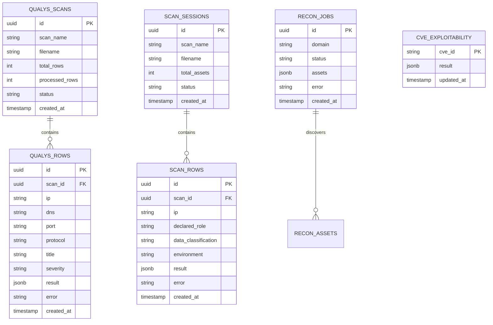

# 08 — Database, Caching & Data Persistence

VMS Automation utilizes a hybrid persistence architecture combining **Supabase (PostgreSQL)** for transactional data, **Redis** for distributed asynchronous queues, and **Local JSON Disk Caches** for API acceleration.

---

## 1. Supabase PostgreSQL Schema & Table Design

All SQL queries are centralized in `backend/db/queries.py` and connected through `backend/db/client.py`.

---

## 2. Table Specifications & Fields

### 2.1 `qualys_scans`
Stores scan session metadata:
- `id` (UUID, Primary Key)
- `scan_name` (Text) — User-provided or auto-derived from filename.
- `filename` (Text) — Source file (e.g., `BSI_Raw_Report.xlsx`).
- `total_rows` (Integer) — Total count of vulnerability entries.
- `processed_rows` (Integer) — Current progress count.
- `status` (Text) — `queued`, `processing`, `completed`, `failed`.
- `created_at` (Timestamp with time zone).

### 2.2 `qualys_rows`
Stores each individual vulnerability record and its enriched intelligence:
- `id` (UUID, Primary Key)
- `scan_id` (UUID, Foreign Key $\rightarrow$ `qualys_scans.id`)
- `ip` (Text) — Asset IP address.
- `dns` (Text) — Hostname / DNS name.
- `port` (Text / Integer) — Target port.
- `protocol` (Text) — `tcp`, `udp`, etc.
- `title` (Text) — Vulnerability title.
- `severity` (Text) — Scanner severity level (1 to 5 or text).
- `result` (JSONB) — Enriched object:
  - `cve_info`: NVD description, CVSS v3.1 base score, vector, CWE.
  - `risk_assessment`: `Risk_Score`, `Business_Impact`, `Remediation_Urgency`.
  - `remediation`: `Detailed_Steps`, `Verification_Steps`, `Rollback_Plan`.
  - `exploit_info`: Live GitHub PoCs and Exploit-DB references.
- `error` (Text, Nullable) — Failure reason if processing fails.
- `created_at` (Timestamp).

### 2.3 `scan_sessions` & `scan_rows`
Dedicated to asset criticality and Nmap network discovery runs.
- `scan_rows.result` (JSONB) stores:
  - `inferred_role`: AI-inferred workload.
  - `criticality_score`: 1.0 to 10.0.
  - `criticality_tier`: `CRITICAL`, `HIGH`, `MEDIUM`, `LOW`.
  - `nmap_results`: Open ports, listening service versions, CPEs.
  - `ip_intel`: AbuseIPDB reputation, Shodan tags, ASN.

### 2.4 `cve_exploitability`
Central lookup table for CVE exploit intelligence:
- `cve_id` (Text, Primary Key) — Normalized CVE (e.g., `CVE-2021-44228`).
- `result` (JSONB) — Combined findings from GitHub, Exploit-DB, PacketStorm, and Vulners, plus the AI exploitability score.
- `updated_at` (Timestamp).

---

## 3. Local JSON Caching Layer

To reduce latency and avoid API rate limits, the platform maintains a fast disk-caching layer under `/cache` and `backend/core/cache`:

| Cache File | Contents | TTL |
|------------|----------|-----|
| `cache/exploit_github.json` | Scraped GitHub PoC repositories per CVE | 24 Hours |
| `cache/exploit_exploitdb.json` | Matched Exploit-DB exploits per CVE | 48 Hours |
| `cache/exploit_packetstorm.json` | Scraped PacketStorm advisories | 48 Hours |
| `cache/exploit_vulners.json` | Vulners API responses | 48 Hours |
| `cache/ip_intel.json` | AbuseIPDB, IPInfo, and Shodan lookups per IP | 7 Days |
| `cache/nmap.json` | Nmap scan results per IP | 24 Hours |

### Cache Implementation Details:
- Implemented in `backend/core/exploit_search/cache.py` and `backend/core/asset_criticality/cache.py`.
- Thread-safe disk reads/writes using standard file locking and hash-keyed storage.
- Expired cache entries are transparently re-fetched from the upstream API and re-cached.

---

## 4. Redis Job Queue (`backend/queue/redis_queue.py`)

When configured via `REDIS_URL` in `.env`:
- Offloads CPU-intensive and network-bound scan tasks from the FastAPI worker thread.
- Distributes batch vulnerability processing across multiple worker processes.
- Falls back to `asyncio` background tasks if Redis is unavailable or unconfigured, ensuring the application remains operational without external dependencies.

