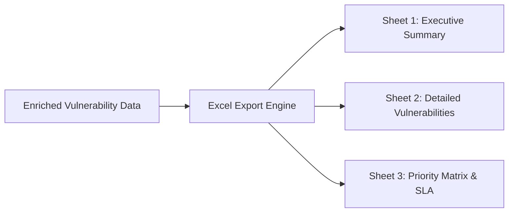

# 09 — Reporting Engines & PowerPoint Automation

A key capability of VMS Automation is the automated synthesis of complex vulnerability intelligence into executive deliverables: formatted Excel spreadsheets and PowerPoint presentation decks.

---

## 1. Advanced Excel Report Generation (`utils/export_excel.py`)

The platform generates multi-sheet Microsoft Excel deliverables (`.xlsx`) using `pandas` and `openpyxl`.

### 1.1 Sheet Structure

Each generated report contains three structured worksheets:



#### Sheet 1: Executive Summary
- **High-Level Statistics**: Total hosts scanned, total vulnerabilities discovered, breakdown by scanner severity (Critical, High, Medium, Low, Info).
- **Asset Criticality Distribution**: Distribution of vulnerabilities across Critical, High, Medium, and Low assets.
- **Top Vulnerabilities**: Most prevalent CVEs and systems with the highest concentration of exploitable findings.

#### Sheet 2: Detailed Vulnerabilities
Contains full technical findings, with each row enriched with intelligence:
- Host IP & DNS.
- Port & Protocol.
- Vulnerability Title & CVE ID(s).
- CVSS v3.1 Base Score & Vector String.
- AI Risk Category & Business Impact Summary.
- AI Remediation Priority & Detailed Remediation Steps.
- Public PoC Availability (`YES` / `NO`) & Reference Links.
- Remediation Urgency & SLA Deadline Date.

#### Sheet 3: Priority Matrix & SLA Tracking
- Implements **TruRisk Adjustment** (`utils/export_utils.py`):
  Combines standard CVSS score with asset criticality and real-world exploitability to produce an adjusted priority tier.
- Calculates **SLA Status**:
  - `BREACHED`: Finding age exceeds designated SLA window.
  - `AT_RISK`: Within 20% of SLA deadline.
  - `COMPLIANT`: Well within SLA resolution window.

---

## 2. Automated PowerPoint Deck Generation (`vms_ppt/`)

Security leadership often requires presentation decks for executive reviews. The `vms_ppt` module automates the generation of structured, professional slides using `python-pptx`.

### 2.1 Slide Deck Catalog (`vms_ppt/slides/`)

The slide generation engine is modularized across ten specialized slide builders:

| Slide # | Source File | Content & Visuals |
|---------|-------------|-------------------|
| **Slide 1** | `slide1.py` | **Title Slide**: Project Name, Client / Department Name, Scan Date, Assessor Metadata. |
| **Slide 2** | `slide2.py` | **Executive Summary & Scope**: Total IP targets, scanning methodology, overall security posture index. |
| **Slide 3** | `slide3.py` | **Vulnerability Severity Breakdown**: Donut / bar chart displaying Critical, High, Medium, and Low distributions. |
| **Slide 4** | `slide4.py` | **Asset Criticality Heatmap**: Cross-tabulation of Asset Criticality vs Vulnerability Severity. |
| **Slide 5** | `slide5.py` | **Top Exploitable CVEs**: Highlights CVEs with active public PoCs and weaponized exploits. |
| **Slide 6** | `slide6.py` | **Attack Chain & Pivoting Simulation**: Visual breakdown of a simulated multi-stage attack path. |
| **Slide 7** | `slide7.py` | **Remediation Strategy & Roadmap**: Dynamic breakdown of immediate, high-priority, and standard tasks. |
| **Slide 8** | `slide8.py` | **SLA Compliance & Age Analysis**: Vulnerability aging distribution and breach status. |
| **Slide 9** | `slide9.py` | **Departmental / Asset Owner Ownership**: Categorization by responsible engineering teams. |
| **Slide 10** | `slide10.py` | **Conclusion & Next Steps**: 30-60-90 day remediation roadmap and sign-off. |

---

## 3. Visual Styling & Brand System (`vms_ppt/config_colors.py`)

Slide generation uses consistent corporate color styling defined in `config_colors.py`:

```python
# Color Palette Constants (RGBColor)
COLOR_CRITICAL = RGBColor(220, 38, 38)     # Red
COLOR_HIGH     = RGBColor(234, 88, 12)     # Orange
COLOR_MEDIUM   = RGBColor(202, 138, 4)     # Amber / Yellow
COLOR_LOW      = RGBColor(22, 163, 74)     # Green
COLOR_NAVY     = RGBColor(15, 23, 42)      # Deep Slate / Dark Theme Background
COLOR_WHITE    = RGBColor(255, 255, 255)   # Clean White
COLOR_GRAY     = RGBColor(148, 163, 184)   # Subtle Muted Text
```

---

## 4. How to Generate Reports Programmatically

### Generating a Presentation Deck from Python:
```python
from vms_ppt.main_ppt import create_remediation_slide
from vms_ppt.ppt import main as generate_deck
import json

# Load scan output data
with open("results.json", "r") as f:
    scan_data = json.load(f)

# Build presentation (.pptx)
generate_deck(scan_data, output_file="output/Executive_VMS_Presentation.pptx")
```

### Generating an Enriched Excel Report:
```python
from utils.export_excel import export_results_to_excel
import json

with open("results.json", "r") as f:
    processed_results = json.load(f)

# Generate in-memory BytesIO spreadsheet
excel_buffer = export_results_to_excel(processed_results)

with open("output/Final_VMS_Report.xlsx", "wb") as f:
    f.write(excel_buffer.getvalue())
```

