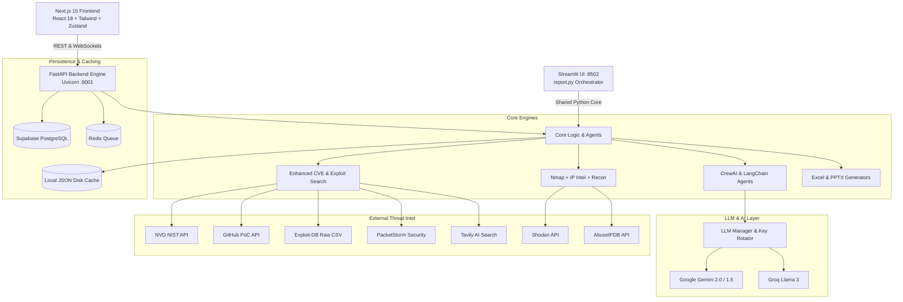

# VMS Automation & Threat Intelligence System — Engineering Handover Documentation

Welcome to the **VMS Automation & Threat Intelligence Platform** documentation suite. This comprehensive handover manual is prepared for engineers taking ownership of the system, covering design architecture, multi-agent AI pipelines, backend APIs, frontend UI, database schemas, local/production runbooks, and developer extension guides.

---

## 1. Project Mission & Overview

**VMS Automation** is an enterprise-grade Vulnerability Management and Asset Intelligence platform. It bridges the gap between raw vulnerability scanner exports (Qualys, Nessus, CSV/Excel vulnerability reports) and high-context threat intelligence. 

Standard vulnerability scanners output thousands of unprioritized findings with static CVSS scores. This platform automates the transformation of those raw findings into actionable cyber defense intelligence by:
1. **Automated Report Enrichment**: Ingesting Qualys/raw Excel reports and correlating findings with real-time multi-source CVE intelligence (NVD NIST, CVE.org, OSV DB).
2. **AI-Driven Risk & Remediation Orchestration**: Utilizing LangChain and CrewAI agents with Google Gemini / Groq LLMs to synthesize business-context risk assessments, step-by-step remediation plans, SLA tracking, and rollback procedures.
3. **Exploitability & Threat Intelligence**: Searching live exploit repositories (GitHub PoCs, Exploit-DB, PacketStorm, Vulners) and calculating automated exploitability scoring.
4. **Asset Criticality & Role Inference**: Combining passive reconnaissance, DNS/WHOIS lookups, IP threat intelligence (Shodan, AbuseIPDB, IPInfo, GreyNoise), and automated nmap port scanning with LLM reasoning to determine asset function, data classification tier, and criticality score.
5. **Attack Chain Simulation**: Simulating multi-hop attacker pivoting scenarios on correlated vulnerability topologies.
6. **Executive Reporting & PowerPoint Generation**: Generating presentation-ready C-level vulnerability decks (`.pptx`) with dynamic charts, remediation roadmaps, and severity matrices.

---

## 2. Documentation Index & Map

This documentation suite is organized into 10 dedicated, deep-dive modules stored under the `/docs` directory:

| # | Document | File Path | Focus Area |
|---|----------|-----------|------------|
| 01 | **Architecture & System Design** | [`docs/01_ARCHITECTURE.md`](01_ARCHITECTURE.md) | High-level system topology, module relationships, data flow diagrams, concurrency models, and tech stack. |
| 02 | **Environment & Setup Guide** | [`docs/02_SETUP_AND_INSTALLATION.md`](02_SETUP_AND_INSTALLATION.md) | Local prerequisites (Python 3.11+, Node.js 18+, Nmap, Redis), `.env` credential setup, and quickstart commands. |
| 03 | **Backend Architecture & APIs** | [`docs/03_BACKEND_API.md`](03_BACKEND_API.md) | FastAPI route inventory, request/response models, background task lifecycles, and WebSocket telemetry. |
| 04 | **AI Multi-Agent Pipeline** | [`docs/04_AI_AGENT_PIPELINES.md`](04_AI_AGENT_PIPELINES.md) | CrewAI and LangChain agents (Risk, Remediation, Attack Chain, Role Inference), prompt designs, and rotation mechanisms. |
| 05 | **Threat Intel & CVE Engines** | [`docs/05_CVE_AND_EXPLOIT_ENGINES.md`](05_CVE_AND_EXPLOIT_ENGINES.md) | NVD NIST, CVE.org, OSV DB, Tavily search, Exploit-DB, PacketStorm, GitHub scraper, and semantic similarity scoring. |
| 06 | **Asset Discovery & Scanning** | [`docs/06_ASSET_CRITICALITY_AND_RECON.md`](06_ASSET_CRITICALITY_AND_RECON.md) | Passive domain recon, DNS resolver, Nmap scan engine, IP intelligence (Shodan/AbuseIPDB), and role inference. |
| 07 | **Frontend Architecture** | [`docs/07_FRONTEND_APPLICATION.md`](07_FRONTEND_APPLICATION.md) | Next.js 15 App Router, React 18, Tailwind CSS, Zustand stores, WebSocket listener, and dynamic route hierarchy. |
| 08 | **Database & Caching Schema** | [`docs/08_DATABASE_AND_STORAGE.md`](08_DATABASE_AND_STORAGE.md) | Supabase PostgreSQL tables, schemas, relations, JSON caching layer, and Redis task queues. |
| 09 | **Reporting & PPT Automation** | [`docs/09_REPORTING_AND_PPTX.md`](09_REPORTING_AND_PPTX.md) | Excel report enrichment engine (`utils/export_excel.py`), slide-by-slide PowerPoint generation (`vms_ppt/`), and color palettes. |
| 10 | **Operations & Troubleshooting** | [`docs/10_OPERATIONS_AND_TROUBLESHOOTING.md`](10_OPERATIONS_AND_TROUBLESHOOTING.md) | Production operations, API quota limits, troubleshooting matrix, failure modes, and developer FAQ. |

---

## 3. High-Level Technology Stack

---

## 4. Key Entry Points & Script Catalog

| Command / Script | Description |
|------------------|-------------|
| `python main.py` | Starts the production FastAPI server on `http://0.0.0.0:8001`. |
| `cd frontend && npm run dev` | Runs the Next.js development web UI on `http://localhost:3000`. |
| `streamlit run report.py --server.port 8502` | Runs the Streamlit interactive vulnerability report processing suite. |
| `python asset_agent.py` | Interactive CLI for standalone Asset Criticality and Risk Scoring. |
| `python passive_recon.py -d <domain>` | CLI for domain DNS/subdomain passive asset discovery. |
| `python -m vms_ppt.main_ppt` | Generates executive vulnerability presentation decks. |
| `python test_db_connection.py` | Tests connectivity to Supabase and verifies table readiness. |
| `python test_cve_search.py` | Verifies CVE lookup and semantic search query generation. |
| `python test_nmap_results.py` | Validates Nmap XML/JSON parsing against real test payloads. |

---

## 5. Developer Handover Checklist

When taking over this project, execute this onboarding routine in order:
- [ ] Read [`01_ARCHITECTURE.md`](01_ARCHITECTURE.md) to understand data flow between UI, API, Supabase, and AI agents.
- [ ] Follow [`02_SETUP_AND_INSTALLATION.md`](02_SETUP_AND_INSTALLATION.md) to configure your `.env` file and install required dependencies.
- [ ] Run `python test_db_connection.py` to ensure Supabase database credentials are valid.
- [ ] Run `python check_api_limit.py` to test your Google Gemini and Groq API keys.
- [ ] Launch both backend (`python main.py`) and frontend (`cd frontend && npm run dev`) and execute a test scan upload using sample reports in `/input`.
- [ ] Review [`10_OPERATIONS_AND_TROUBLESHOOTING.md`](10_OPERATIONS_AND_TROUBLESHOOTING.md) for known edge cases, API rate-limiting handling, and common troubleshooting steps.
